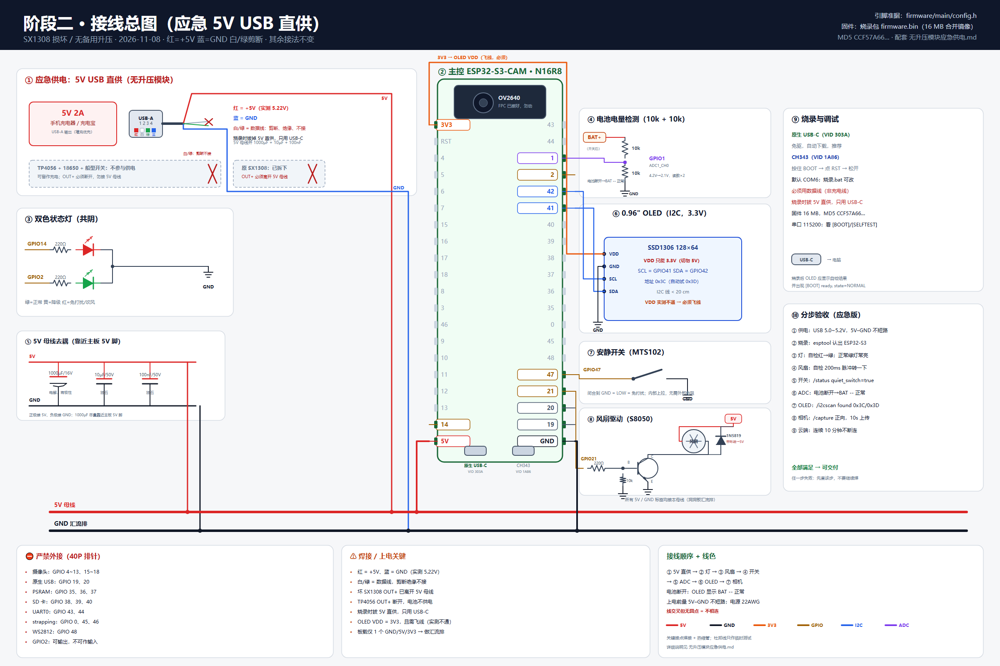

# 无升压模块 · 应急供电方案

> **场景**：SX1308 升压模块损坏，XL3608 备用也没有了，手头没有升压板。
> **结论**：单节 18650 **不能直接接 5V 脚**；用 **5V 2A USB 充电器/充电宝** 直接给 5V 母线供电，今晚就能继续测试。
> 配套：`接线图-阶段二-定稿.md`、`材料清单-阶段二.md`



> 图：红=+5V、蓝=GND、白/绿剪断；坏 SX1308 拆下，TP4056 输出断开，其余外设接法不变。

---

## 0. 先明确一件事

ESP32-S3-CAM 的 **5V 脚需要 4.75~5.25V**。单节 18650 是 3.0~4.2V，直接接 5V 脚会：

- 板载 3.3V LDO 欠压，WiFi 发射/摄像头启动瞬间重启；
- 5V 风扇转不动或转速极低；
- 摄像头、OLED 工作不稳定。

所以 **要么有 5V 电源，要么有升压**。没有升压板时，最实际的办法是找现成的 5V USB 电源（手机充电器、充电宝、USB 排插），**绕过电池和升压**，直接喂 5V 母线。

---

## 1. 方案 A：5V 2A USB 充电器 / 充电宝直供（推荐，0 成本）

### 1.1 接线

```
5V 2A 手机充电器 / 充电宝（USB-A 口）
        │
        ├─ 红（VBUS +5V）──▶ 5V 母线（原 SX1308 OUT+ 的位置）
        │
        └─ 黑（GND）──────▶ GND 汇流排

同时断开：
  ✗ 坏 SX1308 的 OUT+（必须从 5V 母线拆下）
  ✗ TP4056 的 OUT+（电池不参与供电）
  ✓ 保留 1000µF 电容跨接 5V / GND
```

### 1.2 操作步骤

1. **拆掉坏升压模块的输出**：至少把 SX1308 `OUT+` 从 5V 母线断开；最好整个模块拆下，防止输出短路/反灌。
2. **断开 TP4056 的 OUT+**：电池/TP4056 不再给 5V 母线供电。TP4056 可以留着给电池充电，但它的输出不要接 5V。
3. 找一根 **USB-A 线**（或 USB-A 母座转接线端子），剪掉小头，剥出红/黑：
   - 红 = VBUS +5V
   - 黑 = GND
   - 白/绿是数据线，不用
4. **先用万用表量**：红黑之间 5V，红对黑不短路；不要只凭线色，有些线序不同。
5. 红接 **5V 母线**，黑接 **GND 汇流排**；保留 1000µF 电容。
6. 上电前量 5V 母线对 GND：**4.9~5.2V**，且不短路，再接主板。

### 1.3 注意

- 充电器/充电宝输出 **≥2A**；1A 在风扇启动 + WiFi 发射时可能掉压重启。
- 充电宝如果有“小电流模式/常开模式”，打开；ESP32 约 120mA，大多数充电宝不会自动关，但个别 30 秒无操作会关。
- **烧录时拔掉 5V 直供，只用 USB-C 烧录**；运行时拔掉 USB-C，避免两路 5V 打架。
- USB 线的 GND 必须和主板 GND 共地。
- **不要用电脑 USB 口带风扇**：USB 2.0 只有 500mA，USB 3.0 约 900mA，风扇启动会掉压重启。

### 1.4 不想剪线

- 买一根 **USB-A 母座转接线端子**（¥2~5），或 **USB-A 公头转 DC 头/排针**；
- 或直接用充电宝的 USB-A 口 + USB-A 转 2.54 排针线；
- 不要把 USB 线插进主板 USB-C 再从排针取 5V 带风扇——板载 USB 输入二极管/走线余量未知，不推荐长期这样。

### 1.5 线色不是标准红黑（例如红蓝白绿）

标准 USB 线色是：**红 = +5V、黑 = GND、白 = D−、绿 = D+**。
红蓝白绿的线里，**蓝色常被厂家当 GND 用**，但这属于非标线，**不能凭颜色接**。

**识别方法（3 分钟，不用拆插头）**

1. 只把 **USB-A 头插进 5V 墙充**，剪开的四根线悬空。
   - 用墙充，不要用电脑 USB 口；
   - 用充电宝可能不输出（需要检测到负载/按按钮），不适合做这一步。
2. 万用表打到 **直流电压挡**：
   - 红表笔接 **红线**；
   - 黑表笔分别碰 **蓝 / 白 / 绿**。
   - 哪一根读出 **≈5V**，那一根就是 **GND**；红线就是 **+5V**。
3. 常见结果：**红–蓝 ≈ 5V** → 红 = +5V，蓝 = GND；白/绿是数据线，**剪短、热缩、绝缘，不接**。
4. 如果红–蓝、红–白、红–绿都量不到 5V：
   - 换一根标准红黑线；
   - 或买 **USB-A 公头转接线端子**（带 +5V/GND 标识），别硬猜。

> **2026-11-08 实测记录**：本条 USB 线 **红–蓝 = 5.22V**，其余组合约 1.x V（数据线悬空感应）。
> 结论：**红 = +5V、蓝 = GND、白/绿 = 数据线（剪掉不接）**。5.22V 在 USB 5V ±5%（4.75~5.25V）范围内，带载后会略降。

**注意**

- 接板前再量一次极性：红正、蓝负；接反会烧板。
- 线细/长会掉压：0.6A 下 28AWG 1m 可能掉 0.2~0.3V；尽量用 **≤30cm** 的短线，或买转接线端子 + 22AWG 线。
- 接好后量板端 5V：**≥4.8V**；风扇启动瞬间 **≥4.7V**。
- 白/绿千万不要接到 5V 或 GND 上。

### 1.6 USB 只供时，还要不要做电池电量检测？

**纯 USB、不装电池 → 不需要。**

- `BAT --` / `battery_valid:false` 是正常现象，不影响坐姿检测、风扇、WiFi 上传。
- 分压的 **2 只 10k + 100nF 可以不装**；但 **GPIO1 不要悬空**。
- 推荐：**GPIO1 用 10k 下拉到 GND**，固件稳定读到 0V，`battery_valid=false`，不会误报低电量黄灯。
  （悬空时 ADC 可能偶发读到 2.5~5.2V，被当成“低电”，状态灯变黄。）
- 风扇基极的 10k 下拉仍要装，别和分压的 10k 搞混。

**USB 供电、但电池还装着（充电/备用）→ 可保留分压看电压**；不保留也行，同样把 GPIO1 10k 下拉到 GND。

**以后改回电池 + 升压 → 保留分压最省事**，或届时补两颗 10k；GPIO1 的下拉记得拆掉。

---

## 2. 方案 B：5V 充电宝（便携，¥30~50）

- 充电宝内部已经包含升压 + 保护 + 电量，USB-A 输出 5V 2A。
- 用 USB-A 转接线供 5V 母线，接线同方案 A。
- 优点：比裸升压板安全、即插即用；缺点：体积大、自动关机策略不可控，不适合长期装壳。
- 适合 **答辩/演示/临时测试**。

---

## 3. 方案 C：IP5306 / MH-CD42 一体化模块（¥8~15）

如果还想继续用 18650 便携，这是最省事的“替代升压”方案：

```
18650 正极 ──▶ 模块 B+
18650 负极 ──▶ 模块 B−
模块 5V OUT ──▶ 5V 母线
模块 GND    ──▶ GND 汇流排
模块 USB-C  ──▶ 5V 充电器（充电）
```

- 模块集成 3.7V→5V 升压（约 2.1A）+ 锂电充电 + 保护，等于把 **TP4056 + SX1308** 合成一块。
- 原来的 TP4056、坏 SX1308 可以拆掉/不接。
- 注意：部分模块需要 **按一下按钮** 才输出；负载 <50mA 可能自动关，但 ESP32 约 120mA，正常不会关。
- 买的时候确认：**5V 输出、USB-C 充电、带保护**；关键词「IP5306 充电宝模块 5V 2A」「MH-CD42 5V 2A」。

---

## 4. 方案 D：买升压模块（恢复原设计，长期）

| 型号 | 输入 | 输出能力 | 参考价 | 评价 |
|---|---|---|---|---|
| **SX1308** | 2~24V | 2A（4A 限流） | ¥2~3 | 同款替换，接线不变，最省事 |
| **FP6298** | 2.6~5.5V | 4.5A MOSFET | ¥4~6 | **推荐**：专为单锂设计，余量比 SX1308 大 |
| **TPS61088** | 2.7~12V | 3A 同步整流 | ¥10~20 | 效率最高、发热最小，预算够选它 |
| **MT3608** | 2~24V | 标称 2A（实际约 1A） | ¥1~2 | 到处能买到，但余量一般；必须加 1000µF，调 5.1V |

接线都一样（4 根线）：

```
TP4056 OUT+ ──▶ 模块 IN+
TP4056 OUT− ──▶ 模块 IN−
模块 OUT+   ──▶ 5V 母线
模块 OUT−   ──▶ GND 汇流排
```

上电前必须 **空载调到 5.0~5.1V**，再封电位器；输出并 1000µF。
**不要再买 XL3608**：1A 余量贴线，低压带载不稳，是阶段一复位的已知原因。

---

## 5. 方案 E：12V 适配器 + 7805 / LM2596（手头有才考虑）

- **7805**：12V→5V 线性，0.6A 时约 4.2W 发热，必须加散热片；台面测试可以，效率低。
- **LM2596 降压模块**：12V→5.1V，效率高、发热小；需要 12V 电源。
- 只适合 **桌面固定测试**，不适合电池便携。

```
12V 适配器 + ──▶ 7805 IN / LM2596 IN+
12V 适配器 − ──▶ GND
7805 OUT / LM2596 OUT+ ──▶ 5V 母线
GND ──▶ GND 汇流排
```

---

## 6. 绝对不要做

1. ❌ **3.7V 直接接 5V 脚**：欠压重启、相机不工作、风扇不转。
2. ❌ **4×AA 碱性（6V）直接接 5V**：超压、漏液、电压跌落；4×NiMH（4.8V）也只能短时应急，不推荐。
3. ❌ **USB 5V 与升压输出同时接**：两路 5V 打架。
4. ❌ **坏升压模块还挂在 5V 母线上**：可能短路/反灌，先把 OUT+ 拆掉。
5. ❌ **电脑 USB 口带风扇**：500/900mA 不够，掉压重启。
6. ❌ **USB 线不量直接接**：红黑接反会烧板。

---

## 7. 替换后验收（5 项）

1. **空载**：5V 母线对 GND = 4.9~5.2V。
2. **接主板**：OLED 亮 `BOOTING...`，串口有 `[BOOT] posture monitor stage 2`。
3. **自检**：红灯 150ms → 绿灯 150ms；风扇 200ms 脉冲转一下。
4. **10 分钟上传**：`/status` 的 `uptime_s` 持续增加，无重启；WiFi 上传正常。
5. **风扇启动瞬间**：万用表量 5V 母线，不低于 4.7V；如果掉到 4.5V 以下，换 2A 以上电源/加 1000µF。

---

## 8. 采购建议

| 需求 | 买什么 | 预算 |
|---|---|---|
| 今晚继续测 | 家里找 5V 2A 手机充电器 / 充电宝 + USB-A 转接线 | ¥0~5 |
| 继续用 18650 便携 | IP5306 / MH-CD42 模块 | ¥8~15 |
| 恢复原设计（推荐） | FP6298 ×2 或 SX1308 ×2 | ¥8~12 |
| 预算充足/要效率 | TPS61088 ×2 | ¥20~40 |
| 不要买 | XL3608 | — |

---

## 9. 结论

- **没有升压板** → 用 **5V 2A USB 充电器/充电宝直供 5V 母线**，先跑起来。
- **要装壳/便携** → 买 **IP5306 模块** 或 **5V 充电宝**。
- **要恢复原设计** → 买 **FP6298**（首选）或 **SX1308**（同款）。
- **单节 18650 直连 5V 脚** 不可行，不要试。
